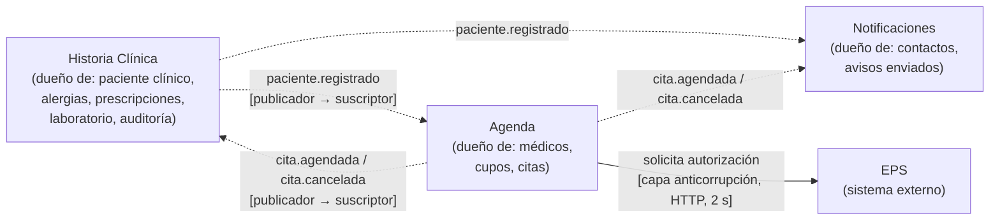

# 3. Estilo, contextos delimitados y tácticas

## 3.1 Estilo elegido

**Microservicios por contexto delimitado, integrados por eventos (publicación/suscripción sobre RabbitMQ), con un API Gateway en el borde.**

- Tres servicios desplegados como procesos separados: **Agenda**, **Historia Clínica** y **Notificaciones**.
- Cada servicio es dueño de sus datos; ningún servicio lee el almacén de otro.
- Entre servicios **no hay llamadas HTTP síncronas**. Se comunican solo por eventos (`paciente.registrado`, `cita.agendada`, `cita.cancelada`) y cada consumidor mantiene la copia local que necesita.
- La única llamada síncrona hacia afuera es Agenda → EPS, protegida con timeout y degradación (ADR-003).

Decisión formal: [ADR-001](adr/ADR-001-microservicios-por-contexto.md) y [ADR-002](adr/ADR-002-integracion-por-eventos-rabbitmq.md).

### Por qué (rastreo a los drivers)

| Decisión de estructura | Driver que la justifica | Mecanismo |
|---|---|---|
| Historia Clínica en un proceso y un almacén propios | **Driver 2** (S1, S2; RS1, RS2) | Los datos clínicos tienen un único dueño. Una vulnerabilidad en Agenda o en Notificaciones no expone historias, y la custodia, retención y exportación (RS3) se gestionan en un solo lugar |
| Agenda como único escritor de los cupos | **Driver 1** (C1) | La regla "un cupo, una cita" se protege en una sola sección crítica. No hay otra base ni otro servicio que pueda asignar un cupo |
| Integración asíncrona por eventos | **Driver 3** (D2) | Si Notificaciones o Historia Clínica están caídos, Agenda sigue aceptando citas y los eventos esperan en colas durables |
| EPS detrás de un adaptador con timeout | **Driver 3** (D1), M1 | Una EPS lenta no retiene al paciente ni bloquea la reserva de otros |
| Agenda escala por separado | P1 (M,A), RS5 | En el pico solo crece Agenda. Historia Clínica, que es la más sensible, no se toca |

### Qué sacrifica

| Atributo que empeora | Por qué | Por qué es aceptable |
|---|---|---|
| **Consistencia inmediata** | La historia muestra una cita recién agendada unos milisegundos después. Un paciente recién registrado no puede agendar hasta que Agenda recibe `paciente.registrado` | Ningún driver exige consistencia inmediata entre contextos. La única consistencia fuerte que importa (el cupo) se mantiene dentro de un solo servicio |
| **Simplicidad operativa** | Seis contenedores en lugar de uno, un broker que operar y logs repartidos | El costo es fijo y lo absorbe Docker Compose. A cambio se obtienen el aislamiento de datos y de fallos que exigen los drivers 2 y 3 |
| **Latencia y depuración** | Hay saltos de red (gateway → servicio) y los flujos se reparten entre procesos | El flujo crítico (agendar) toca un solo servicio más la EPS |
| **Atomicidad entre contextos** | No hay transacción que abarque "guardar la cita" y "publicar el evento" | Riesgo documentado (R1) con mitigación conocida (outbox) |
| **Minimización de datos personales** | Nombre, documento y correo se copian a Agenda y Notificaciones | Son datos personales, **no clínicos**. Riesgo R6 |

---

## 3.2 Contextos delimitados

*Línea punteada: evento asíncrono. Línea continua: llamada síncrona.*

| Contexto | Qué contiene (lenguaje propio) | Frontera: qué queda fuera | **Señal que justifica la frontera** |
|---|---|---|---|
| **Agenda** | Médico, cupo, cita, estado de la cita, autorización EPS, cancelación | No sabe nada clínico: ni alergias, ni diagnósticos, ni resultados | **Concurrencia y ritmo de demanda distintos:** es lo único que recibe ráfagas (RS5) y lo único con una regla de exclusión mutua (C1). **Cambia por motivos operativos** (horarios, políticas de cancelación, convenios con EPS) que no afectan lo clínico. Para Agenda, "paciente" es *alguien con documento y EPS que ocupa un cupo* |
| **Historia Clínica** | Paciente como sujeto clínico, alergias, registro clínico, prescripción, resultado de laboratorio, auditoría de accesos | No asigna cupos ni envía avisos | **Regulación propia** (RS1–RS3): confidencialidad, inalterabilidad, retención y auditoría que no aplican a la agenda. **Lingüística:** aquí "paciente" es *alguien con antecedentes y alergias*, un concepto distinto del de Agenda. **Actor dominante distinto:** el médico, no la recepción |
| **Notificaciones** | Contacto, canal, mensaje, aviso enviado | No decide nada del negocio. Solo reacciona | **Integración con un proveedor externo** (correo/SMS) que tiene su propia tolerancia a fallos y demoras. Es **puramente reactivo**: si se cae, nadie debe enterarse (D2). **Cambia por razones de canal** (agregar WhatsApp, M2), no de negocio clínico |

### Fronteras evaluadas y descartadas

| Candidato | Por qué **no** se separó |
|---|---|
| **Prescripción** como servicio aparte | La regla de alergias necesita las alergias del paciente en la misma operación. Separarla obligaría a enviar datos clínicos por la red o a copiarlos, lo que contradice el driver 2 |
| **Laboratorio** como servicio aparte | Es el mismo actor (médico), los mismos datos sensibles y la misma regulación. No hay una señal de cambio independiente que lo justifique |
| **Identidad / autenticación** como servicio aparte | Debería serlo: en producción sería un proveedor de identidad (por ejemplo, Keycloak) validado en el gateway. En el esqueleto el login vive en Historia Clínica por simplicidad (riesgo R4) |
| **Facturación con la EPS** | Fuera del alcance del proyecto |

### Mapa de relaciones

- **Historia Clínica → Agenda / Notificaciones:** *publicador–suscriptor*. Historia Clínica es upstream del concepto "paciente registrado". Los consumidores son *lectores tolerantes*: cada uno lee solo los campos que usa.
- **Agenda → Historia Clínica / Notificaciones:** *publicador–suscriptor* de los cambios de cita.
- **Agenda → EPS:** *capa anticorrupción*. El modelo de la EPS (`SolicitudEps`, `RespuestaEps`) se traduce a `ResultadoAutorizacion` en el paquete `eps` y no entra al dominio.

---

## 3.3 Tácticas aplicadas

| # | Táctica | Atributo | Escenario | Dónde está en el código | **Qué degrada** |
|---|---|---|---|---|---|
| T1 | **Único escritor + sección crítica** sobre la reserva de cupos | Integridad | E1 | `AgendaService.reservarCupo` (`synchronized`) | **Rendimiento y escalabilidad:** las reservas se serializan, y con dos réplicas de Agenda el bloqueo deja de proteger (R2) |
| T2 | **Llamada externa fuera de la sección crítica** | Rendimiento / disponibilidad | E1, E2 | `AgendaService.agendar` | Hay una ventana de hasta 2 s en la que la cita existe sin autorización confirmada |
| T3 | **Timeout + degradación elegante** (estado `PENDING_AUTHORIZATION`) | Disponibilidad | E2 | `EpsHttpAdapter`, `AgendaService.agendar` | **Consistencia con la EPS:** se reserva un cupo que puede terminar negado. Aparece un estado más, que alguien (recepción) debe resolver (R5) |
| T4 | **Mensajería asíncrona con colas durables** | Disponibilidad | E4 | `EventosConfig` en cada servicio | **Latencia** de los avisos y **consistencia eventual**. El broker se vuelve un punto único de falla (R7) |
| T5 | **Consumidor idempotente** | Integridad / disponibilidad | E4 | `NotificacionService.enviar` (claves procesadas), proyecciones por *upsert* | Memoria para las claves procesadas. En producción requiere un almacén de deduplicación |
| T6 | **Limitar la exposición / minimizar los datos en eventos** | Seguridad | E3 | Contratos de `Eventos.java`; los datos clínicos solo están en `historia-clinica-service` | Las consultas que cruzan contextos necesitan copias locales. Se **duplican** datos personales (R6) |
| T7 | **Auditar accesos** | Seguridad (no repudio) | E3 | `HistoriaClinicaService.verHistoriaCompleta` | Cada lectura implica una escritura adicional y el almacenamiento de auditoría crece sin límite |
| T8 | **Hash de credenciales (bcrypt)** | Seguridad | S3 | `PacienteService` | Unos ~100 ms de CPU por login, deliberadamente |
| T9 | **Encapsular / intermediario** (puerto `AutorizadorEps` + adaptador) | Modificabilidad | E5 | `dominio/AutorizadorEps`, `eps/EpsHttpAdapter` | Una indirección más y un mapeo de modelos |
| T10 | **Gateway con resolución dinámica** (un servicio caído solo afecta sus rutas) | Disponibilidad | E4 | `servicios/gateway/nginx.conf` | Un salto de red adicional. El gateway es el punto único de entrada |

### Tácticas diseñadas pero **no** materializadas en el esqueleto

| Táctica | Para qué | Por qué no está |
|---|---|---|
| Autenticación OIDC/JWT y autorización por rol en el gateway | S4 | Requiere un proveedor de identidad. No cambia la estructura demostrada (R4) |
| Outbox transaccional | Garantizar la publicación de eventos (R1) | Requiere una base de datos transaccional por servicio |
| Restricción única `(médico, cupo)` en base de datos | C1 con varias réplicas (R2) | El esqueleto usa memoria |
| Circuit breaker hacia la EPS | Dejar de llamar a una EPS caída | El timeout ya cumple la medida de E2. El circuit breaker reduce carga, no latencia percibida |
| Cifrado en reposo de la historia clínica | RS2 | Depende del motor de base de datos |
