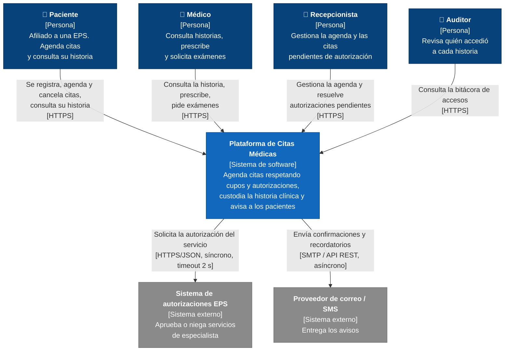
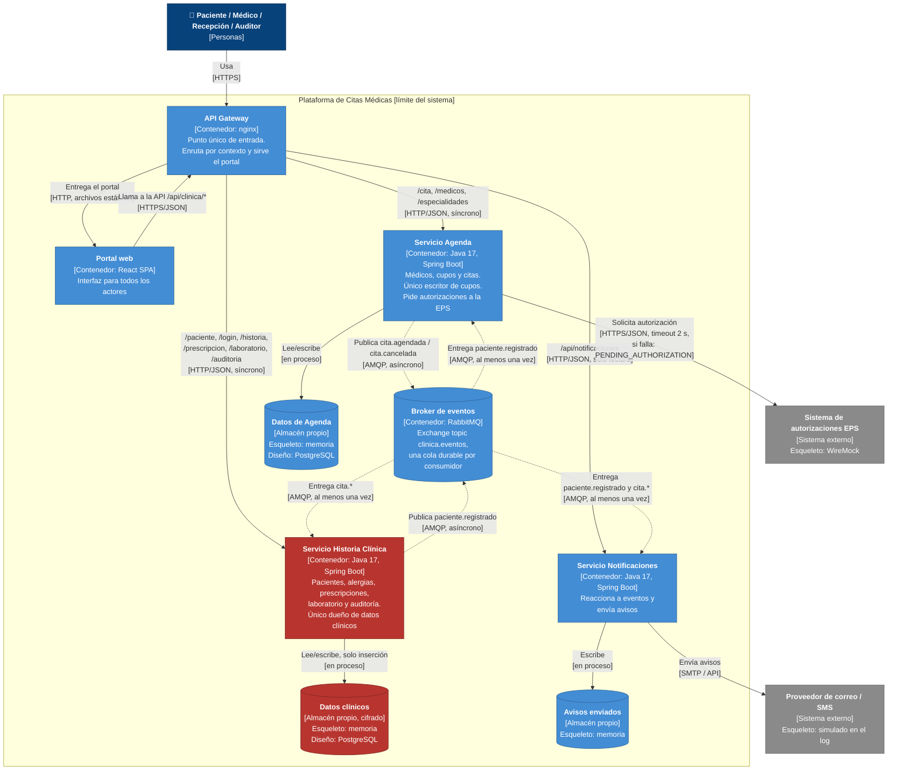

# 5. Diagramas C4

Los diagramas están escritos en Mermaid (GitHub, GitLab, VS Code y Obsidian los dibujan directamente). La notación sigue C4: personas, sistema, sistemas externos y contenedores. **Cada flecha indica qué se hace y con qué tecnología o protocolo**, y cada diagrama trae su leyenda.

---

## Nivel 1 · Diagrama de contexto

**Leyenda (nivel 1)**

| Elemento | Significado |
|---|---|
| 🟦 azul oscuro | Persona (actor humano) |
| 🟦 azul | El sistema que construimos |
| ⬜ gris | Sistema externo que **no** controlamos |
| Flecha | Relación dirigida: *qué hace* + **[tecnología / modo]** |

---

## Nivel 2 · Diagrama de contenedores

**Leyenda (nivel 2)**

| Elemento | Significado |
|---|---|
| 🟦 azul oscuro | Persona |
| 🟦 azul claro | Contenedor de la plataforma (proceso desplegable por separado) |
| 🟥 rojo | Contenedor o almacén con **datos clínicos sensibles** (Ley 1581 y Res. 1995). Solo hay uno de cada uno |
| ⬜ gris | Sistema externo |
| Cilindro | Almacén de datos o broker |
| **Flecha continua** | Llamada **síncrona** (HTTP). El que llama espera la respuesta |
| **Flecha punteada** | Mensaje **asíncrono** (evento AMQP). El publicador no espera a nadie |
| Texto de la flecha | *Qué hace* + **[protocolo, modo, garantías]** |

### Correspondencia diagrama ↔ código

| Caja del diagrama | Carpeta | Proceso en `docker-compose.yml` | Puerto |
|---|---|---|---|
| Portal web + API Gateway | repositorio `SistemaSitasMedicasFrontend` (`frontend/`) y `servicios/gateway` | `gateway` | 8080 |
| Servicio Agenda | `servicios/agenda-service` | `agenda` | 8081 |
| Servicio Historia Clínica | `servicios/historia-clinica-service` | `historia-clinica` | 8082 |
| Servicio Notificaciones | `servicios/notificaciones-service` | `notificaciones` | 8083 |
| Broker de eventos | (imagen oficial) | `rabbitmq` | 5672 / 15672 |
| Sistema de autorizaciones EPS | `servicios/eps-simulador` | `eps-simulador` | 8090 |

Si el diagrama dice seis contenedores, `docker compose ps` muestra seis procesos.
